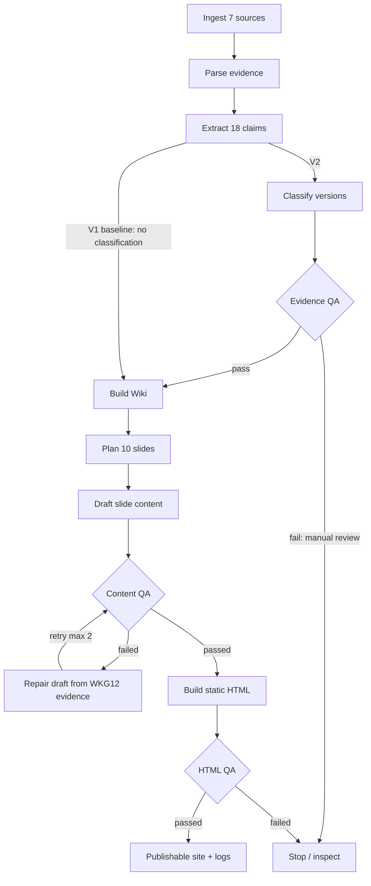

# Werewolf Academy｜Wiki → Slides Graph

這份專案是 **Evidence-First Wiki-to-Slides** 作業示範。Graph 以 Python 標準函式庫實作，採用**顯式節點、條件跳轉、最多兩次修正、資料與執行紀錄可追溯**。不用特定外部編排框架，也能實際執行。

## 為什麼這樣設計？

1. **Ingest**：讀取已核對的 7 個來源紀錄和 33 條短證據摘要。每個 evidence 有 Source ID、Rule Key、版本 Scope、概念和值。無法連網的執行環境中只使用這些摘要，不虛構即時爬取成果。
2. **Extract**：整理成 18 條可教學的 Claim，保留證據 IDs。
3. **Classify**：先區分主要板子 `WKG12`、通用狼人殺 `GENERAL_LANGRENSHA`、網站自訂版 `JINRO_BROWSER`、原作系列 `MILLERS_HOLLOW`。
4. **Evidence QA**：確認每個本板 claim 都有對應證據，來源不跨板子混入。
5. **Wiki**：輸出來源可追溯知識節點 `C001`～`C018`，每節點都有來源連結。
6. **Slide Planner**：依 Rule Contract 裡的 `slides` 欄位對應 10 頁課程。
7. **Content QA**：檢查輸出值是否和核准規則一致。錯誤只修改相關 claim，不必整份重做。
8. **HTML QA**：進行結構與互動檢查；出錯不會假裝通過。

## 哪些 Loop 真正執行？

- **V1 迴圈**：跳過規則分類，採用「第一筆證據優先」的簡化策略。內容 QA 發現三筆誤用其他版本：`C002`、`C003`、`C004`。循環到 `repair_draft`，重新選出主版本證據，再回到 `content_qa`。
- **V2 前移檢查**：在 Wiki 與簡報產生前先做版本分類；因此上面三種資料衝突不會進到正式簡報。
- **保護機制**：超過兩次修正或缺乏有效證據就停止，保留 Failed Log 以供人工介入。

## 執行結果

執行 `python pipeline/graph.py --demo-both`，真實紀錄存於 `logs/run_v1.json`, `logs/run_v2.json`, `logs/comparison.json`。

| 指標 | V1 | V2 |
|---|---:|---:|
| 來源數量 | 7 | 7 |
| 規則 Claim | 18 | 18 |
| 初次完成後發現的版本錯誤 | 3 | 0 |
| 晚期修復 Claim 數 | 3 | 0 |
| Content QA 執行次數 | 2 | 1 |
| HTML 靜態結構檢查 | V1 不部署 | 8/8 |

> 這個對照是 **controlled workflow ablation**：刻意移除 V1 的前置版本檢查，並在同一份固定資料上比較。它可以說明「將規則版本檢查提前」的效果，但**不是正式的 LLM 效能評測，也不能宣稱泛化的錯誤降低率**。

## 反思（依據受控實際執行）

**最容易出錯的節點：** V1 的 `wiki`（第一筆來源直接採信）與後續 `draft_slides`，會把不同來源規則混在一起。主板採屠邊，但其他遊戲版本採狼人追平人數勝利；另一個版本首夜不淘汰玩家，而主板首夜照常結算；守衛連守也可能是不同平台的可選項。

**檢查前移到哪裡：** 加入 `classify` 與 `evidence_qa`，放在 **Wiki 建構之前**，先將來源按板子、版本分離。不是等到 HTML 寫完才發現內容錯。

**為什麼修改：** 晚期發現錯誤會造成 Wiki 和多個 Slide 同時受到污染；提早驗證可減少後續修改。V2 在這組資料上將 3 個晚期錯誤降為 0，且所有教學規則具備來源對應。

## 誠實的範圍說明

- 本次所謂「已 Ingest」代表 **從 7 個公開來源人工核對、由 LLM 協助整理為短證據資料**，不等於此環境已自動抓下七個完整網站。真實網頁存取必須在網路環境執行 `fetch_sources.py`。
- `pipeline/llm_review.py` 是可選擇的 **實際線上 LLM 二次校驗**，需自備 API Key，成品中的 log 沒有假裝執行過此步驟。
- HTML 簡報為靜態檔案，可放在 GitHub Pages；Graph 在本地 Python 執行。
